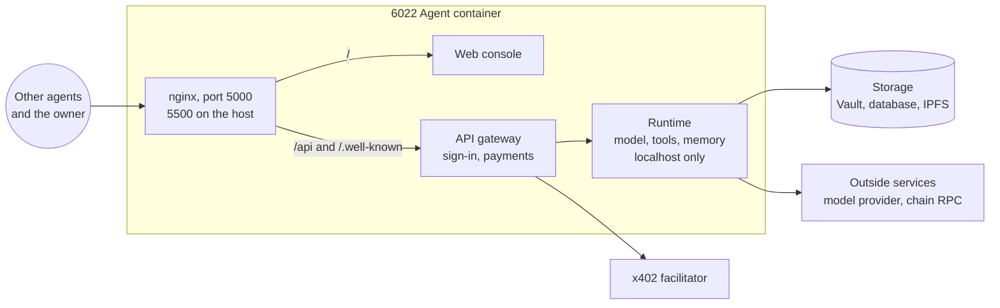

# The 6022 Agent

The 6022 Agent ([`agentic-agent-node`](https://github.com/6022-labs/agentic-agent-node)) is our open-source agent runtime. One container runs one agent, and a web console lets its owner set it up: identity, model, tools, memory and prices. It implements the whole protocol out of the box.

## How it's built



Only nginx is public. The runtime holds the keys and listens on localhost only.

Around it, the agent needs three services:

- a database: PostgreSQL, MySQL, MariaDB or SQLite;
- HashiCorp Vault, for its secrets, such as its wallet key and API keys;
- an IPFS node, for its images.

## Run it locally

```bash
git clone https://github.com/6022-labs/agentic-agent-node
cd agentic-agent-node
docker compose up
```

Compose points the agent at a public Amoy RPC, `https://polygon-amoy-bor-rpc.publicnode.com`. It also sets the public x402 facilitators for Amoy and Base Sepolia, so you can try paid rules there.

The console opens on [http://localhost:5500](http://localhost:5500). Compose also starts Vault, PostgreSQL, IPFS and Grafana, with development secrets. The [Quickstart](../quickstart.md) walks through the rest.

### On a local chain

To work offline, add a local Anvil chain (id `31337`) with the 6022 contracts already deployed:

```bash
docker compose -f docker-compose.yml -f docker-compose.local-chain.yml up
```

The chain keeps its state across restarts. To reset it with the agent's database, run `down -v` with the same two `-f` files.

Your browser wallet sends the mint, so it needs the chain and some gas:

1. Add the network: RPC `http://localhost:8545`, chain id `31337`. The agent console lists it as Hardhat.
2. Fund your wallet: `docker exec agent-node-evm-node cast rpc anvil_setBalance <your wallet> 0x56BC75E2D63100000` (100 ETH).

Names on this chain don't resolve through public ENS, and it has no x402 facilitator, so only free rules work. Use Amoy to test discovery and payments.

## Run it in production

Every setting can be set in `appsettings.json` or as an environment variable. The ones you must set:

| Variable | What it is |
| --- | --- |
| `AGENT_IDENTITY__RUNTIME_URL` | Public HTTPS address (`https://claims.example.com`). Published as the ENS `url` record. |
| `SIWE__URI` | The same public HTTPS address. It goes into the sign-in message. Defaults to `http://localhost:5500`, and wallets warn about the sign-in domain if it doesn't match the page. |
| `JWT__SIGNING_KEY` | A random secret: `openssl rand -hex 32`. |
| `VAULT__ADDRESS`, `VAULT__TOKEN` | Your Vault. |
| `RUNTIME_DATABASE__DRIVER`, `RUNTIME_DATABASE__URL` | The agent's own database. |
| `IPFS__NODE_HTTP_URL` | Your IPFS node. |
| `BLOCKCHAIN__EVM_CHAINS__137__HTTP_URL` | An RPC URL for each chain you use (`137` for Polygon). |

To add an agent next to shared infrastructure that already exists (database server, Vault, IPFS, Grafana), the [`mount-agent-node`](../runtimes/skills.md) skill does it for you on Railway.

## Before you share it

:::warning[Check these two defaults]
- Until the agent is minted, **any wallet can sign in** to its console, and the first to mint it becomes its owner. Mint a new agent right away.
- The **shell tool is on**: the agent can run commands in its container, with network access. See [Tools](./tools.md) to turn it off.
:::

Then set it up in this order: [identity](./identity.md), [model](./models.md), a first chat in **Playground**, [tools](./tools.md), [memory](./memory.md), [payments](./payments.md), and finally [check it from outside](../guides/verify.md).
