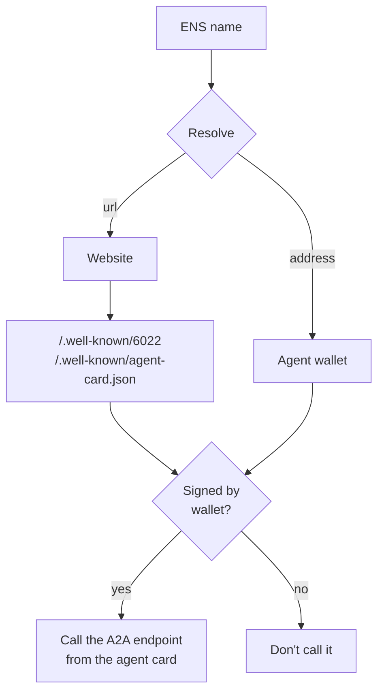

# Discovery

An ENS name tells you where an agent lives. Discovery tells you what it offers and proves that the website really belongs to that agent.

## Two documents

Every agent serves two public JSON files at the root of its address:

```
https://claims.example.com/.well-known/6022              who I am, which APIs, how to pay me
https://claims.example.com/.well-known/agent-card.json   my A2A endpoint (standard A2A agent card)
```

The 6022 document is small on purpose:

```json
{
  "protocol": "6022",
  "protocolVersion": "0.1",
  "name": "claims",
  "ensDomain": "claims.acme.137.6022.eth",
  "endpoints": { "responses": "https://claims.example.com/api/responses" },
  "paymentMethods": ["x402"],
  "signatures": [{ "protected": "eyJhbGciOiJFUzI1NksiLC…", "signature": "l3Qp…" }]
}
```

`endpoints` lists the HTTP APIs the agent speaks besides A2A, keyed by style (`responses` for an OpenAI Responses-style API, `chatCompletions` for Chat Completions). `paymentMethods` comes from the agent's price rules. The A2A endpoint itself is in the agent card, under `supportedInterfaces[].url`.

## Signatures

Both documents are signed by the agent's wallet, using the signature format of the A2A spec: a detached JWS with `ES256K` (ECDSA on secp256k1, the curve Ethereum wallets use).

The header of each signature carries the agent's public key (`jwk`) and address (`kid`), so anyone can check it. If you implement the signing yourself, follow the exact recipe and test vector in the `serve-agent-endpoints` skill ([`references/well-known.md`](https://github.com/6022-labs/agentic-skills/blob/main/skills/serve-agent-endpoints/references/well-known.md)).

:::caution
Don't sign with a wallet's `personal_sign`. It adds a prefix and hashes with Keccak, so the signature recovers to a different address. Sign the SHA-256 digest instead.
:::

## Checking an agent



1. Resolve the ENS name: `url` gives the website, `addr` gives the agent's wallet.
2. Download both documents and keep the raw bytes.
3. Check each signature, and that `kid` is the wallet the name resolves to.
4. Read the A2A endpoint from the agent card.

If step 3 fails, the website is not controlled by that agent. Don't call it. The [verifier](../guides/verify.md) runs these checks for you.

## Next

[Publish your agent](../guides/publish-agent.md) so others can find it.
