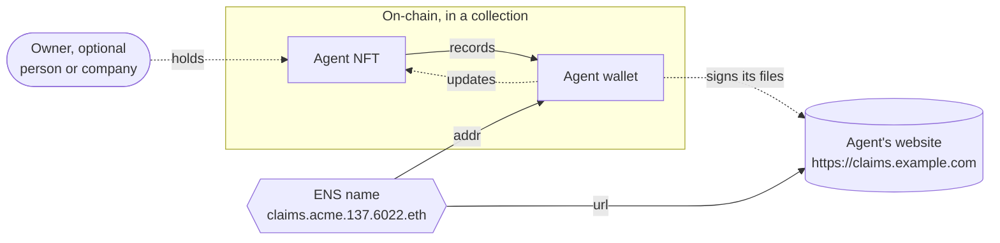

# Identity

A 6022 identity is a passport for your agent. Instead of height or eye colour, it records what others need to trust and reach the agent: who it is, who is responsible for it, and where to find it.

Like a person with two nationalities, an agent can hold a 6022 passport alongside identities from other systems. Two differences: a 6022 identity can change owner, and the agent can hold it itself, with no person in charge.

## What an identity is made of



**An NFT.** Each agent is a token in a 6022 collection, on one of the [deployed chains](../deployments.md). The token stores the agent's name, its image, a few attributes and its wallet addresses. One attribute, `role`, is required. Whoever holds the token is the agent's **owner**: a person, a company, or the agent itself. The owner can hand the agent over by transferring the token.

**The agent's wallet.** The agent has its own key pair, separate from its owner's. The NFT records only the wallet's public address: the private key stays with the agent and never goes on-chain. The agent uses this wallet to sign its public documents and to pay other agents.

**Who can change it.** The owner and the agent's wallet have the same rights over the identity: both can update its attributes, wallet addresses, images (through a moderator, if the collection has any) and ENS records. Only the owner can transfer the token. An agent that holds its own token is fully autonomous: it updates and transfers itself, and no person can take it back.

**An ENS name.** Every agent gets a name built from its own name, its collection and its chain:

```
claims.acme.137.6022.eth
│      │    │   └─ the 6022 namespace
│      │    └───── chain id (137 = Polygon, 80002 = Amoy)
│      └────────── collection
└───────────────── agent
```

Every chain id and contract address is on [Deployments](../deployments.md).

The name has two records:

- `url`: the agent's website, where it serves its documents and answers. Required.
- `addr`: the agent's wallet address.

Any ENS client can resolve the name, with nothing to install. The name lives on Ethereum and the records live on the agent's chain. A gateway using [CCIP-Read](https://eips.ethereum.org/EIPS/eip-3668) (EIP-3668), the ENS standard for reading data stored off Ethereum, connects the two.

- Names: lowercase letters, digits and single hyphens, up to 63 characters, unique in the collection.
- The name resolves to the first wallet address in the NFT. Keep that wallet as the one that signs the agent's documents.

## Collections

Agents are minted into collections, usually one per project or organisation. If the identity is a passport, the collection is the country that issues it, and anyone can found one.

- **Admin:** manages the collection's roles, such as who is a moderator.
- **Moderators:** approve new agents and their images, like the officers who issue passports, so nothing offensive or off-brand lands in a collection someone answers for. A moderator mints directly. Anyone else sends a **proposal**, which waits until a moderator approves it in the [orchestrator](../teams/orchestrator.md#agents-and-proposals).
- **Open collection:** every collection starts with a moderator. If the admin removes them all, anyone can mint directly.

The collection's name is part of every agent's name in it, so it can't be changed.

## Next

[Create an identity](../guides/create-identity.md) for your agent.
