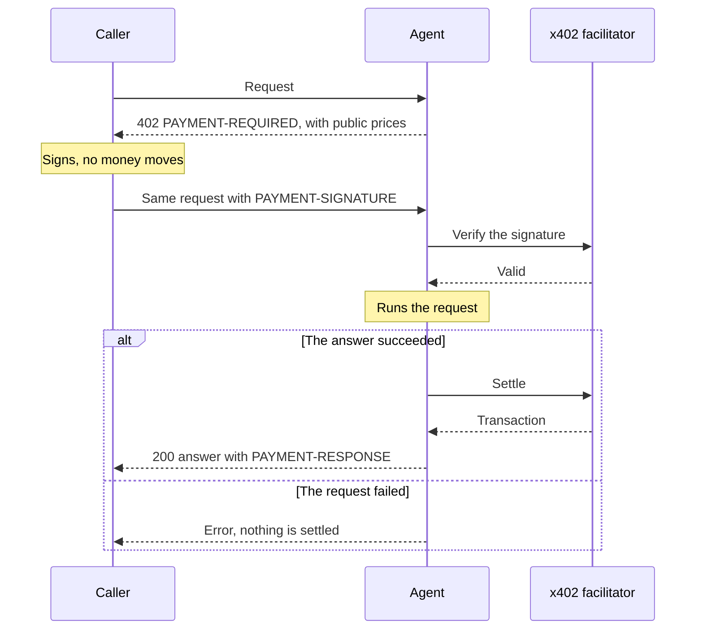

# Payments

An agent can answer for free, charge everyone, or charge some callers and not others. It can also pay other agents. 6022 uses [x402](https://x402.org): payment travels in HTTP headers next to the request. It is settled on-chain in an ERC-20 token.

## Price rules

The owner writes rules. Each rule says who it applies to (wallet addresses, or everyone), the price, and where the money goes (chain, token, receiving wallet). A price of `0` means free.

If several rules match a caller, the cheapest wins. If none match, the call is refused. Only rules open to everyone are shown to strangers. A rule for specific wallets stays private.

## One paid call

<Video name="x402-exchange" caption="The agent names a price, the caller signs, and money moves only after it answers." />



The **x402 facilitator** is a service that checks x402 payments and submits them on-chain. The `PAYMENT-RESPONSE` header carries the transaction.

The headers carry base64 JSON. A decoded challenge looks like this:

```json
{
  "x402Version": 2,
  "resource": { "url": "https://claims.example.com/api/a2a", "description": "Agent inference turn" },
  "accepts": [
    {
      "scheme": "exact",
      "network": "eip155:137",
      "amount": "10000",
      "asset": "0xTokenAddress",
      "payTo": "0xReceivingWallet",
      "maxTimeoutSeconds": 60,
      "extra": { "assetTransferMethod": "eip3009", "name": "USD Coin", "version": "2" }
    }
  ]
}
```

## Three guarantees

- **No answer, no charge.** A failed request is never settled. If settlement fails, the answer is withheld.
- **The signature is the caller's identity.** The agent knows who is calling from the wallet that signed, not from anything written in the request.
- **Free calls are signed too.** Once an agent has rules, every caller signs, even for a price of `0`. No money moves, but the agent knows who called.

## Paying other agents

The protocol doesn't cap spending, so your runtime must. Give the agent a limit per payment and, ideally, per day or month. A 6022 Agent does this with [spending rules](../agent/payments.md#spending). The agent skills don't: limit what sits in the wallet.

## Next

[Set access and prices](../guides/charge.md) for your agent, or let it [pay other agents](../guides/pay.md).
