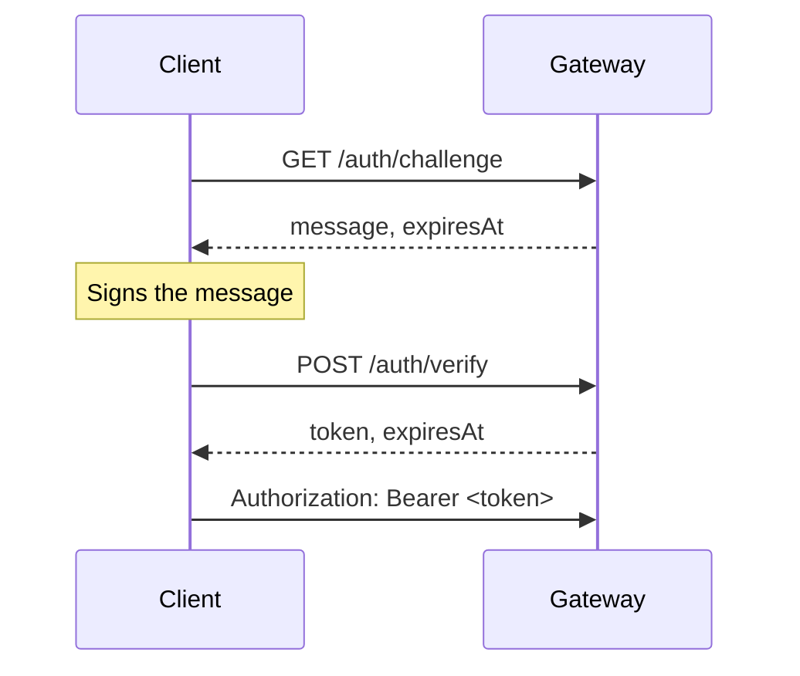

# Authentication

The gateway has no passwords. You prove you control a wallet by signing a one-time message, and the gateway returns a JWT.



The private key never leaves the client.

## Get a challenge

`GET /auth/challenge` · Public

The message is an [EIP-4361](https://eips.ethereum.org/EIPS/eip-4361) (Sign-In with Ethereum) message. Sign it exactly as returned. A new challenge for the same address replaces the previous one.

| Query | Required | Description |
| --- | --- | --- |
| `address` | Yes | The wallet signing in, `0x` followed by 40 hex characters. |
| `chainId` | Yes | The chain of the connected wallet, for example `137` (Polygon) or `80002` (Amoy). |

Response `200`:

```json
{
  "message": "orchestrator.example.com wants you to sign in with your Ethereum account:\n0xAbC...\n\nSign in to the 6022 orchestrator.\n\nURI: https://orchestrator.example.com\nVersion: 1\nChain ID: 137\nNonce: ...\nIssued At: 2026-09-30T10:00:00Z\nExpiration Time: 2026-09-30T10:05:00Z",
  "expiresAt": "2026-09-30T10:05:00Z"
}
```

| Status | When |
| --- | --- |
| `400` | The address is malformed. |

## Exchange the signature for a token

`POST /auth/verify` · Public

The challenge can be used once.

```json
{
  "address": "0xAbC...",
  "signature": "0x..."
}
```

`signature` is the `personal_sign` (EIP-191) signature of the message: `0x` followed by 65 bytes in hex.

Response `200`:

```json
{
  "token": "eyJhbGciOiJIUzI1NiIs...",
  "expiresAt": "2026-09-30T11:00:00Z"
}
```

| Status | When |
| --- | --- |
| `400` | The address or signature is malformed. |
| `401` | The challenge expired or was already used (`challenge_not_found`), or the signature doesn't match the address (`signature_mismatch`). |

## Use the token

Send it on every call that needs a session:

```bash
curl https://orchestrator.example.com/conversations \
  -H "Authorization: Bearer <token>"
```

A missing, invalid or expired token gets `401`. There's no refresh endpoint: sign in again.

## Examples

Python, with `eth-account` and `requests`:

```python
import requests
from eth_account import Account
from eth_account.messages import encode_defunct

BASE_URL = "https://orchestrator.example.com"
wallet = Account.from_key("0x<private key>")

challenge = requests.get(
    f"{BASE_URL}/auth/challenge",
    params={"address": wallet.address, "chainId": 137},
).json()

signed = wallet.sign_message(encode_defunct(text=challenge["message"]))

token = requests.post(
    f"{BASE_URL}/auth/verify",
    json={"address": wallet.address, "signature": "0x" + signed.signature.hex().removeprefix("0x")},
).json()["token"]
```

JavaScript, with `ethers` v6:

```js
import { Wallet } from "ethers";

const BASE_URL = "https://orchestrator.example.com";
const wallet = new Wallet(process.env.PRIVATE_KEY);

const params = new URLSearchParams({ address: wallet.address, chainId: "137" });
const { message } = await (await fetch(`${BASE_URL}/auth/challenge?${params}`)).json();

const signature = await wallet.signMessage(message);

const { token } = await (
  await fetch(`${BASE_URL}/auth/verify`, {
    method: "POST",
    headers: { "Content-Type": "application/json" },
    body: JSON.stringify({ address: wallet.address, signature }),
  })
).json();
```

:::warning
Use a dedicated wallet for scripts. Never put the key of a wallet that owns valuable agents in a script, a CI variable or a shared `.env` file.
:::

## What the token contains

The token is an HS256 JWT signed with `JWT__HASH`. Its claims:

| Claim | Meaning |
| --- | --- |
| `sub` | The wallet address that signed in. |
| `iat` | Issued at. |
| `nbf` | Not before. |
| `exp` | Expiry, `JWT__LIVING_TIME` seconds after issue. |

The token isn't tied to a chain. The `chainId` you pass only goes into the signed message.

## Ownership

A token proves you control a wallet, not an agent. Some endpoints also check that the wallet owns the agent or is the agent's wallet.

| Check | Endpoints | Otherwise |
| --- | --- | --- |
| The wallet in `sub` holds the agent's NFT or is the agent's wallet | [Prompt templates](./agents.md#get-a-prompt-template) | `403`, code `agent_access_forbidden` |
| The same, for one agent in the conversation | [A single conversation and its sub-routes](./conversations.md#access) | `403`, code `conversation_access_forbidden` |

Ownership follows the NFT's on-chain transfers, after a short delay for block finality. Nobody has access to an agent that isn't minted yet. If the registry can't be reached, you get `502`.

## Signed requests

Instead of a token, a caller can sign each request with its wallet. Send three headers:

| Header | Value |
| --- | --- |
| `X-Agentic-Orchestrator-Timestamp` | Unix time in seconds. Rejected if more than 60 seconds away from the gateway's clock (`SIWE__SIGNED_REQUEST_MAX_AGE_SECONDS`). |
| `X-Agentic-Orchestrator-Nonce` | 16 to 128 random letters, digits, `-` or `_`. Each nonce works once per wallet. |
| `X-Agentic-Orchestrator-Signature` | The EIP-191 (`personal_sign`) signature of the message below, `0x` followed by 65 bytes in hex. |

The signed message is these eight lines, joined with `\n`:

```text
6022 orchestrator signed request
<gateway domain, the host of SIWE__URI>
<METHOD>
<path, without the query, as the gateway receives it>
<raw query string, or an empty line>
<timestamp>
<nonce>
<Keccak-256 of the raw body, 0x-prefixed lowercase hex>
```

```ts
import { Wallet, hexlify, keccak256, randomBytes, toUtf8Bytes } from "ethers"

const wallet = new Wallet(process.env.PRIVATE_KEY!)
const body = JSON.stringify({ content: "You are {{.Agent.Name}}..." })
const timestamp = Math.floor(Date.now() / 1000).toString()
const nonce = hexlify(randomBytes(16)).slice(2)
const message = [
  "6022 orchestrator signed request",
  "orchestrator.example.com",
  "POST",
  "/agent/0x1234.../3/prompt-template/expert-system",
  "",
  timestamp,
  nonce,
  keccak256(toUtf8Bytes(body)),
].join("\n")
const signature = await wallet.signMessage(message)
```

Behind a reverse proxy that rewrites paths, sign the path the gateway sees, not the public one. A request with a wrong, expired or reused signature is treated as unauthenticated.

## Gateway settings

| Variable | Default | Description |
| --- | --- | --- |
| `JWT__HASH` | None | HMAC secret for the JWTs. At least 32 characters. Required. |
| `JWT__LIVING_TIME` | None | Token lifetime in seconds. Required. |
| `JWT__NONCE_TTL` | `300` | How long a challenge stays valid, in seconds. |
| `SIWE__URI` | `http://localhost:5173` | The URI in the sign-in message. Its host becomes the message's domain, which wallets show. Set it to your console's public URL. |
| `SIWE__STATEMENT` | `Sign in to the 6022 orchestrator.` | The statement line of the message. |
| `SIWE__SIGNED_REQUEST_MAX_AGE_SECONDS` | `60` | How far a [signed request](#signed-requests)'s timestamp may be from the gateway's clock, in seconds. |
