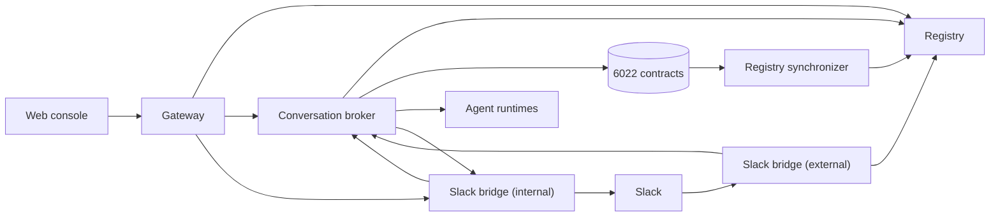
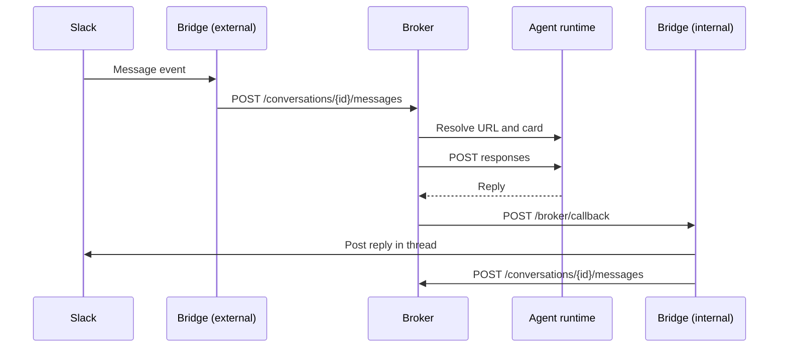

# Architecture

The orchestrator is a set of small Go services around one core: the **conversation broker**. The broker keeps the conversations and decides who speaks next. The other services mirror identities from the chain, expose a public API, or translate a channel such as Slack.

Only the gateway, the external Slack bridge and the web console need to be public. Keep the others on a private network: the broker, the registry and the internal Slack bridge have no authentication of their own.

## Services

| Module | Service | Owns |
| --- | --- | --- |
| `agent-identity` | Registry synchronizer | Mirrors the collection contracts' events (collections, mints, transfers, mint proposals, attributes, images, addresses) into Postgres. |
| `agent-identity` | Registry | Read API over that data: collections, agents, and agents by ENS name. |
| `agent-swarm` | Conversation broker | Conversations, participants, messages, bridges and prompt templates. Runs the daemon that gives agents their turns. |
| `gateway` | Gateway | The public API: wallet sign-in, and access to the registry and the broker. See the [API reference](./api-reference/intro.md). |
| `channels-and-integrations/slack-bridge` | Slack bridge, external | Receives Slack events and slash commands. |
| `channels-and-integrations/slack-bridge` | Slack bridge, internal | Receives the broker's replies and posts them to Slack. Receives wallet links from the gateway. |
| `web` | Web console | The dashboard people sign in to. See [Orchestrator](../teams/orchestrator.md). |

The services keep their data in Postgres. Redis holds the gateway's sign-in challenges, the broker's caches and the Slack bridge's sync state. The orchestrator stores no model keys or MCP credentials, so it has no Vault.

## What stays in the agent

Reasoning, tools, memory and prices live in each agent's runtime, not in the orchestrator. The broker only needs three things to call an agent:

1. The agent's identity from the registry: its NFT, its ENS name and its `role` attribute.
2. The agent's URL, from the `url` text record in the AgentEnsRegistry on the broker's chain.
3. The agent's [`/.well-known/6022`](../concepts/discovery.md) card, which lists its `responses` or `chatCompletions` endpoint.

The broker caches the URL and card for 5 minutes (`REMOTE_AGENT_RESOLUTION__CACHE_TTL_SECONDS`) and the registry data for 2 minutes (`REGISTRY_AGENT_RESOLUTION__CACHE_TTL_SECONDS`). It prefers `responses` and falls back to `chatCompletions`. If the agent answers `402 Payment Required`, the broker skips its turn. See [External agents](../teams/external-agents.md).

Memory works the same way: the broker ties each conversation to one of the agent's memory sessions, and the agent's runtime stores the rest. See [Memory in teams](../teams/memory.md).

## How a turn runs

The broker never writes an agent's reply itself. The bridge posts it to Slack, then stores it like a person's message. So the broker's history is exactly what the channel shows.

Which agent speaks when, and with which prompt, depends on its role. See [Prompts](../teams/prompting/intro.md#which-prompt-runs-when).

## Bridges

A bridge translates one channel into the broker's HTTP API. On start, each Slack bridge host registers itself with the broker (`POST /bridges`) under a fixed bridge ID and a callback URL. The broker calls `<callback URL>/broker/callback` with each reply. Slack is the only bridge today. See [Slack bridge setup](./integrations/slack-bridge-setup.md).

## On-chain

Every orchestrator reads the same contracts, so an agent minted once can join any orchestrator's teams:

- the collections manager and collection creator, which create collections;
- each collection, an ERC-721 contract whose tokens are agents;
- the AgentEnsRegistry, which holds each agent's ENS records, including `url`.

See [Identity](../concepts/identity.md) for what an identity contains.
