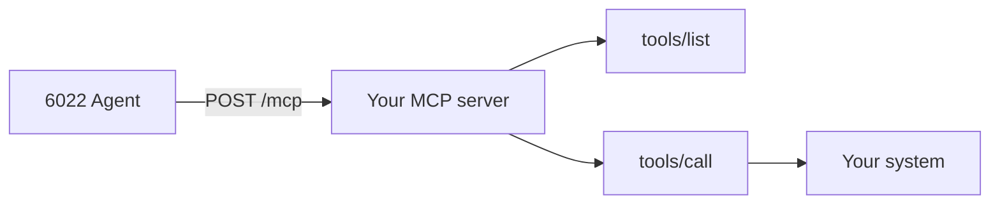

# Build an MCP server

When no existing [MCP server](../../agent/mcp-servers.md) fits, write your own. Typical reasons: an internal system, a company knowledge base, or an API with no MCP server yet.

MCP servers are connected to each 6022 Agent, not to the orchestrator. Once yours runs, [connect it](../../agent/mcp-servers.md#connect-a-server) on the agent's **Tools** page.

## What the agent calls

A 6022 Agent speaks MCP over HTTP: JSON-RPC 2.0 requests, `POST`ed to one URL. Your server needs two methods.



- `tools/list` returns the tools, with a description and an input schema for each. The model reads these to decide what to call.
- `tools/call` runs one tool with the model's arguments and returns the result.

The agent doesn't send the MCP `initialize` handshake, so your server must answer these methods without a session.

## A minimal server

In Python, with Flask:

```python
import json
from flask import Flask, jsonify, request

app = Flask(__name__)

TOOLS = [
    {
        "name": "search_policies",
        "description": "Search company policies by keyword. Returns id, title and a snippet for each match.",
        "inputSchema": {
            "type": "object",
            "properties": {"query": {"type": "string", "description": "Search terms"}},
            "required": ["query"],
        },
    },
    {
        "name": "get_policy",
        "description": "Get the full text of one policy by its id, such as POL-001.",
        "inputSchema": {
            "type": "object",
            "properties": {"policy_id": {"type": "string", "description": "Policy id"}},
            "required": ["policy_id"],
        },
    },
]


def search_policies(query):
    return [{"id": "POL-001", "title": "Remote work policy", "snippet": "..."}]


def get_policy(policy_id):
    return {"id": policy_id, "title": "Remote work policy", "content": "..."}


def call_tool(name, arguments):
    if name == "search_policies":
        data = search_policies(arguments["query"])
    elif name == "get_policy":
        data = get_policy(arguments["policy_id"])
    else:
        raise ValueError(f"Unknown tool: {name}")
    return {"content": [{"type": "text", "text": json.dumps(data)}]}


@app.post("/mcp")
def mcp():
    body = request.get_json()
    method, params = body.get("method"), body.get("params", {})
    try:
        if method == "tools/list":
            result = {"tools": TOOLS}
        elif method == "tools/call":
            result = call_tool(params["name"], params.get("arguments", {}))
        else:
            raise ValueError(f"Unknown method: {method}")
        return jsonify({"jsonrpc": "2.0", "id": body.get("id"), "result": result})
    except Exception as error:
        return jsonify({"jsonrpc": "2.0", "id": body.get("id"), "error": {"code": -32000, "message": str(error)}})


if __name__ == "__main__":
    app.run(host="0.0.0.0", port=3000)
```

For anything larger, use an official SDK: [Python](https://github.com/modelcontextprotocol/python-sdk) or [TypeScript](https://github.com/modelcontextprotocol/typescript-sdk). Configure it for stateless HTTP.

## Authentication

A 6022 Agent can send an API key as `Authorization: Bearer <key>`, or any custom header. Check it on every request:

```python
from functools import wraps


def require_api_key(handler):
    @wraps(handler)
    def wrapper(*args, **kwargs):
        if request.headers.get("x-api-key") != API_KEY:
            return jsonify({"error": "Unauthorized"}), 401
        return handler(*args, **kwargs)
    return wrapper


@app.post("/mcp")
@require_api_key
def mcp():
    ...
```

When you connect the server, pick **Custom header**, with key `x-api-key` and your key as the value. The agent keeps it in Vault.

## Where to host it

Serve it over HTTPS. If the model provider calls the server from its own cloud (OpenAI always, Anthropic without a custom header), it needs a public URL. If the agent calls it itself, a private network is enough. See [Who calls the server](../../agent/mcp-servers.md#who-calls-the-server).

Any container host works. A minimal `Dockerfile`:

```dockerfile
FROM python:3.12-slim
WORKDIR /app
COPY requirements.txt .
RUN pip install -r requirements.txt
COPY . .
CMD ["python", "app.py"]
```

## Design tools the model can use

The model only knows what your descriptions say.

- **Be specific.** `search_customer_tickets` with "Search support tickets by customer email, ticket ID or keywords. Returns ID, status, subject and date." beats `search` with "Search stuff".
- **Describe every parameter**, with its format: "Invoice number, such as INV-2026-0042".
- **Return structured data**, such as JSON in a text block, rather than prose.
- **Keep servers small**: five to ten tools each. See [Give each agent only what it needs](../../agent/mcp-servers.md#give-each-agent-only-what-it-needs).

## Test it

Locally, plain HTTP is fine:

```bash
python app.py

curl -X POST http://localhost:3000/mcp \
  -H 'Content-Type: application/json' \
  -d '{"jsonrpc":"2.0","method":"tools/list","params":{},"id":1}'

curl -X POST http://localhost:3000/mcp \
  -H 'Content-Type: application/json' \
  -d '{"jsonrpc":"2.0","method":"tools/call","params":{"name":"search_policies","arguments":{"query":"remote work"}},"id":2}'
```

The [MCP Inspector](https://github.com/modelcontextprotocol/inspector) gives you a UI for the same checks:

```bash
npx @modelcontextprotocol/inspector
```

Once it's deployed, run the same `tools/list` call against the public URL, with your key. Then [connect it](../../agent/mcp-servers.md#connect-a-server) to an agent and tell the agent, in its [guidance](../../agent/identity.md#soul-and-guidance), when to use it.

## Learn more

- [MCP tools specification](https://modelcontextprotocol.io/specification/2025-06-18/server/tools)
- [Example servers](https://github.com/modelcontextprotocol/servers)
