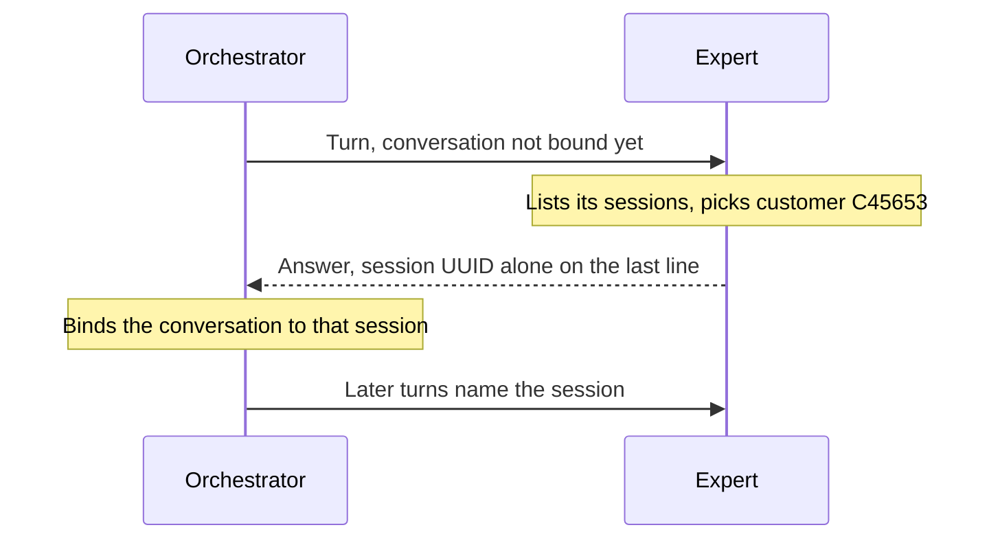

# Memory in teams

Memory belongs to each agent, not to the orchestrator. The orchestrator keeps the thread; each agent decides what it remembers, in its own runtime.

An expert that handles hundreds of customers needs the right history each time. So the first time an expert joins a conversation, the orchestrator asks it which of its memory sessions the conversation belongs to. The orchestrator then **binds** the conversation to that session.

## Binding

Every expert gets this request, whatever its runtime. A 6022 Agent does it with its [memory tools](../agent/memory.md). The id must be alone on the last line, or the orchestrator may grab the wrong UUID, like an order id ([details](./prompting/expert.md#binding)).

## Name sessions after what they're about

The expert picks by name, so names decide whether binding works. Put the business key first, and keep one object per session:

| Agent | Session names |
| --- | --- |
| Customer care | `customer C45653` |
| Claims | `claim CLM-2025-00142` |
| GDPR | `GDPR article 15` |
| Accounting | `invoice INV-2025-0001` |
| Support | `ticket TKT-8889f6a1` |

Keep the format stable (`customer C45653` everywhere, not `cust 45653` elsewhere). When there's no key, a clear subject such as `refund procedure` still works.

## Where knowledge comes from

An expert can know things in three ways:

- **Past conversations**, stored in its sessions. The agent starts empty and learns from real exchanges.
- **Context you inject** before the first conversation, such as a policy or a procedure. See [Memory](../agent/memory.md#give-it-context-in-advance).
- **Live data from tools**, such as a CRM through MCP, for anything that changes. See [Tools](../agent/tools.md).

Use memory for what the agent should remember, and tools for what it should look up.
